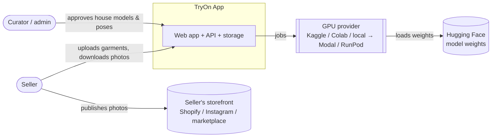
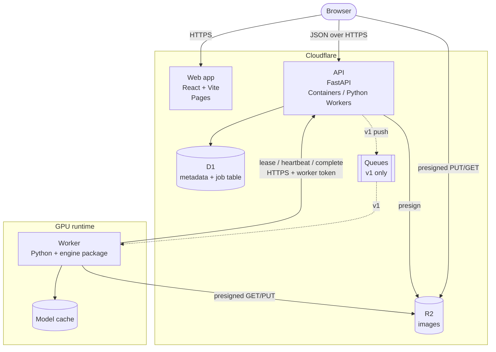
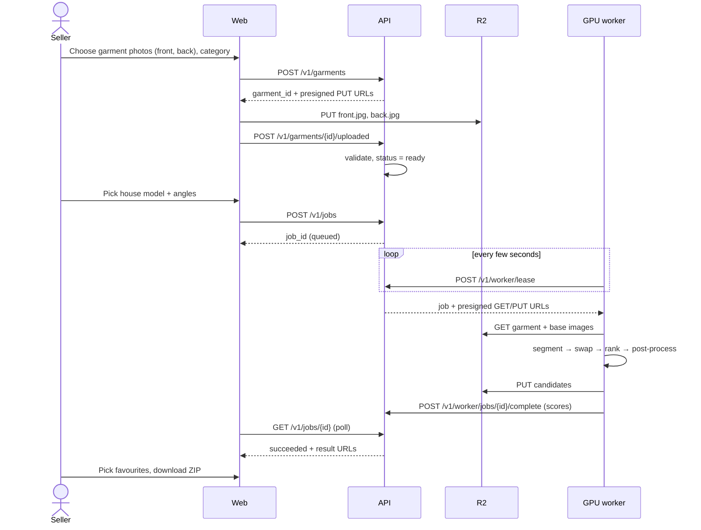

# 01 — System context

Diagrams follow the [C4 model](https://c4model.com/). They are Mermaid, so GitHub renders them.

## Level 1: system context

## Level 2: containers

### Notes

- **Images never pass through the API.** Browser and worker read and write R2 directly with short-lived presigned URLs. The API only handles small JSON. This keeps the API inside Cloudflare's request and CPU limits.
- **The worker only makes outbound calls.** It needs no public IP or inbound port, which is why free notebooks and a home PC can act as workers.
- **D1 is the job queue in v0** (lease columns on the `job` table). Cloudflare Queues are added only when push-based serverless GPUs arrive (see [ADR-0002](adr/0002-pull-based-gpu-worker.md)).

## Main user flow (sequence)

