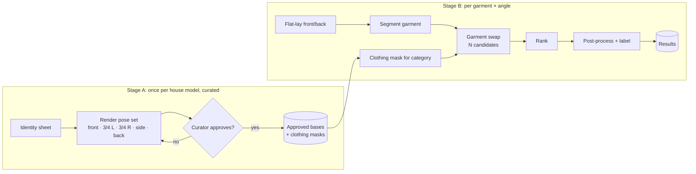

# 03 — Generation pipeline

How we produce **realistic** on-model photos that stay **consistent across angles**.

## Why not just text-to-image?

Prompting "a man wearing this t-shirt, side view" with a new image every time produces:
- a different face, body and lighting every time, so the catalog looks inconsistent;
- garment drift: the logo moves, the colour shifts, buttons appear or disappear;
- invented backs and sides of the product.

We split the problem so that each hard part is solved **once** and checked by a person.

## Two stages



### Stage A: house models and pose library (curated, offline)

1. **Identity:** generate a synthetic person from a written spec (e.g. *"Arjun: 30s, 6 ft, North Indian, athletic, short black hair"*). Pick the best of many seeds. Never use a real person's likeness.
2. **Identity sheet:** 4–6 neutral, well-lit images of that person used as references.
3. **Pose set:** render the person in the fixed angles, in a **neutral base outfit** (plain fitted tee + neutral trousers), same studio light, same seamless background, same camera height and focal length. Multi-reference editing (FLUX.2 [klein] 4B) keeps the identity; a small face/identity LoRA is the fallback if drift is too high.
4. **Masks:** precompute clothing-region masks per category (upper body, lower body, full body) for every base with a human-parsing model, then let a person correct them if needed.
5. **Approval:** a curator approves each base. Only approved bases are visible to sellers.

Cost is paid once and shared by every seller and SKU, so it can be slow and manual.

### Stage B: per-garment swap (automated, per job)

For each requested angle:

| Angle | Base | Garment reference | Notes |
|---|---|---|---|
| Front | front base | front flat-lay | Highest confidence |
| 3/4 left / right | 3/4 base | front flat-lay | Print slightly foreshortened |
| Back | back base | **back flat-lay (required)** | Blocked in the UI without a back photo |
| Side | side base | front + back | Beta: lower confidence, labelled as such |

Steps:
1. **Prepare garment:** remove the background, crop, normalise white balance, segment the garment from the flat-lay. Detect obvious upload problems (blurred photo, garment cut off, person in shot) and fail early with `INPUT_INVALID`.
2. **Swap:** inpaint the base's clothing mask using the garment image as a visual reference. Pixels outside the mask are copied back exactly, so face, hands, hair and background are untouched.
3. **Candidates:** generate N (default 4) with different seeds.
4. **Rank** (see below) and keep the top 2 for the seller. Drop candidates below a threshold; if all are below it, the angle fails with `LOW_FIDELITY` and doesn't charge credits.
5. **Post-process:** optional upscale, background colour (white / brand colour), crop to catalog ratios (4:5, 3:4, 1:1), WebP + JPEG.
6. **Label:** visible small "AI-generated model" mark (seller can position it) + IPTC `DigitalSourceType = trainedAlgorithmicMedia` and C2PA manifest when practical.

## Engine interface

```python
class TryOnEngine(Protocol):
    name: str
    version: str

    def prepare_garment(self, image: Image, category: Category) -> PreparedGarment: ...

    def swap(
        self,
        base: PoseBase,               # image + clothing mask + angle
        garment: PreparedGarment,
        params: SwapParams,           # seeds, steps, strength, n_candidates
    ) -> list[Candidate]: ...
```

Implementations:
- `MockEngine`: pastes the garment into the mask with a simple warp. No GPU. Used for API/UI development and CI.
- `KleinMultiRefEngine`: FLUX.2 [klein] 4B (Apache 2.0) multi-reference edit + mask compositing. **v0 default**, assuming Phase-0 evaluation passes.
- Candidates to evaluate later: dedicated open virtual try-on models (e.g. CatVTON, Leffa, Oxygen-TryOn) or a paid API. Each must clear the licence policy in [ADR-0004](adr/0004-open-weight-model-and-licence-policy.md) first.

Each result records `engine.name` and `engine.version`, so outputs can be traced and compared.

## Ranking

| Signal | How | Why |
|---|---|---|
| Colour fidelity | ΔE between garment colour histograms (flat-lay vs masked output, in Lab) | Colour mismatch is the top cause of returns |
| Pattern fidelity | DINOv2 (or CLIP) embedding similarity, garment crop vs flat-lay | Prints and logos |
| Identity | Face-embedding similarity vs identity sheet | Same model across the catalog |
| Leak / artefact | Pixel difference outside the mask ≈ 0; simple hand/edge heuristics | Realism |

`score = weighted sum` with weights tuned on the eval set. Scores are stored per result to support later tuning.

## Evaluation

`research/eval/` holds a **fixed** set of about 20 real flat-lays spread across difficulty:
plain tee, logo tee, all-over print, striped shirt, button-down, kurta, sleeveless top, dress, jeans.

For each engine version, a notebook runs every garment × angle and fills in a sheet:
- pass/fail against the [quality bar](00-overview.md#quality-bar-catalog-quality), with a reason code
- automatic scores
- seconds per image and peak VRAM

**Phase-0 exit criterion:** at least 70% pass on simple upper-body garments, front and 3/4 views. Below that, change the engine before building more of the app.

## Known hard cases (expected failures)

- Fine text on prints, small logos (keep a person in the loop, offer a "regenerate").
- Sheer fabrics, heavy embroidery, sequins.
- Loose garments whose silhouette differs a lot from the base outfit (dresses on a tee+trousers base). Needs per-category bases.
- Fit and size: the photo shows *a* fit, not the shopper's fit. Product copy should say so.
