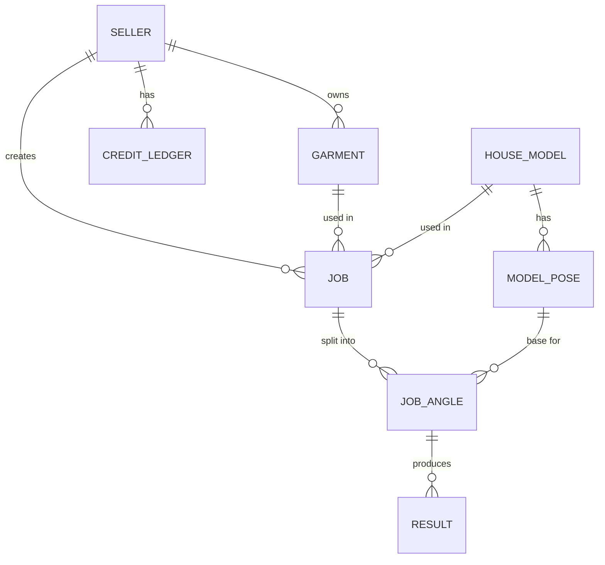

# 04 — Data model

D1 is SQLite, so the same schema runs locally (SQLite file) and in production (D1).
IDs are ULIDs as text: sortable by time, safe in URLs. Timestamps are ISO-8601 UTC text.

## Entities



## Schema (v0)

```sql
CREATE TABLE seller (
  id            TEXT PRIMARY KEY,
  email         TEXT NOT NULL UNIQUE,
  display_name  TEXT,
  role          TEXT NOT NULL DEFAULT 'seller',      -- seller | admin
  created_at    TEXT NOT NULL
);

CREATE TABLE garment (
  id            TEXT PRIMARY KEY,
  seller_id     TEXT NOT NULL REFERENCES seller(id),
  name          TEXT,
  sku           TEXT,
  category      TEXT NOT NULL,                       -- top | shirt | kurta | dress | bottom | ...
  front_key     TEXT,                                -- R2 key
  back_key      TEXT,
  status        TEXT NOT NULL DEFAULT 'pending_upload', -- pending_upload | ready | rejected
  reject_reason TEXT,
  created_at    TEXT NOT NULL
);
CREATE INDEX idx_garment_seller ON garment(seller_id, created_at);

CREATE TABLE house_model (
  id            TEXT PRIMARY KEY,
  name          TEXT NOT NULL,
  attributes    TEXT NOT NULL,                       -- JSON: height_cm, skin_tone, body_type, presentation, region
  status        TEXT NOT NULL DEFAULT 'draft',       -- draft | approved | retired
  created_at    TEXT NOT NULL
);

CREATE TABLE model_pose (
  id             TEXT PRIMARY KEY,
  house_model_id TEXT NOT NULL REFERENCES house_model(id),
  angle          TEXT NOT NULL,                      -- front | three_quarter_left | three_quarter_right | side | back
  base_outfit    TEXT NOT NULL DEFAULT 'tee_trousers',
  base_key       TEXT NOT NULL,
  masks          TEXT NOT NULL,                      -- JSON: {"upper": key, "lower": key, "full": key}
  approved_at    TEXT,
  approved_by    TEXT REFERENCES seller(id),
  UNIQUE (house_model_id, angle, base_outfit)
);

CREATE TABLE job (
  id             TEXT PRIMARY KEY,
  seller_id      TEXT NOT NULL REFERENCES seller(id),
  garment_id     TEXT NOT NULL REFERENCES garment(id),
  house_model_id TEXT NOT NULL REFERENCES house_model(id),
  params         TEXT NOT NULL,                      -- JSON: n_candidates, background, ratio
  state          TEXT NOT NULL DEFAULT 'queued',     -- see 05-api-contracts.md
  priority       INTEGER NOT NULL DEFAULT 0,
  attempts       INTEGER NOT NULL DEFAULT 0,
  lease_owner    TEXT,                               -- worker id
  lease_until    TEXT,
  error_code     TEXT,
  error_detail   TEXT,
  engine         TEXT,                               -- name@version that ran it
  idempotency_key TEXT UNIQUE,
  created_at     TEXT NOT NULL,
  started_at     TEXT,
  finished_at    TEXT
);
CREATE INDEX idx_job_queue  ON job(state, priority DESC, created_at);
CREATE INDEX idx_job_seller ON job(seller_id, created_at);

CREATE TABLE job_angle (
  id            TEXT PRIMARY KEY,
  job_id        TEXT NOT NULL REFERENCES job(id),
  angle         TEXT NOT NULL,
  model_pose_id TEXT NOT NULL REFERENCES model_pose(id),
  state         TEXT NOT NULL DEFAULT 'pending',     -- pending | succeeded | failed
  error_code    TEXT,
  UNIQUE (job_id, angle)
);

CREATE TABLE result (
  id            TEXT PRIMARY KEY,
  job_angle_id  TEXT NOT NULL REFERENCES job_angle(id),
  candidate_idx INTEGER NOT NULL,
  image_key     TEXT NOT NULL,
  thumb_key     TEXT NOT NULL,
  scores        TEXT NOT NULL,                       -- JSON: colour, pattern, identity, leak, total
  seed          INTEGER,
  selected      INTEGER NOT NULL DEFAULT 0,
  created_at    TEXT NOT NULL,
  UNIQUE (job_angle_id, candidate_idx)
);

CREATE TABLE credit_ledger (
  id          TEXT PRIMARY KEY,
  seller_id   TEXT NOT NULL REFERENCES seller(id),
  delta       INTEGER NOT NULL,                      -- +grant / -charge / +refund
  reason      TEXT NOT NULL,                         -- signup_grant | job_charge | job_refund | purchase
  job_id      TEXT REFERENCES job(id),
  created_at  TEXT NOT NULL
);
-- balance = SUM(delta) per seller; an append-only ledger avoids lost updates

CREATE TABLE worker (
  id          TEXT PRIMARY KEY,
  label       TEXT,                                  -- "kaggle-1", "home-4070"
  engine      TEXT,
  last_seen   TEXT
);
```

**Why `job_angle` exists:** one angle can fail (e.g. a low-fidelity back view) while
the others succeed. The seller is charged per successful angle and can regenerate just one.

## R2 object layout

```
sellers/{seller_id}/garments/{garment_id}/front.jpg
sellers/{seller_id}/garments/{garment_id}/back.jpg
sellers/{seller_id}/garments/{garment_id}/prepared/{front|back}.png   # segmented, cached
sellers/{seller_id}/jobs/{job_id}/{angle}/{candidate_idx}.webp
sellers/{seller_id}/jobs/{job_id}/{angle}/{candidate_idx}_thumb.webp
sellers/{seller_id}/exports/{job_id}.zip
models/{house_model_id}/identity/{n}.png
models/{house_model_id}/poses/{angle}/{base_outfit}/base.png
models/{house_model_id}/poses/{angle}/{base_outfit}/mask_{upper|lower|full}.png
```

- The seller id prefix makes ownership checks and per-seller deletion simple.
- R2 lifecycle rules: delete unselected candidates after 30 days and exports after 7 days.
- Uploads are re-encoded on the worker to strip EXIF (location data).

## Migrations

Plain numbered SQL files in `apps/api/migrations/` (`0001_init.sql`, …), applied with
`wrangler d1 migrations apply` in production and the same files through `sqlite3` locally.
