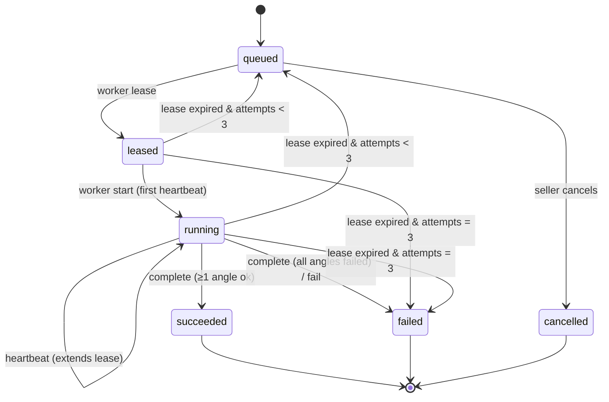

# 05 — API contracts

All endpoints are under `/v1`, JSON in and out, errors in one shape:

```json
{ "error": { "code": "INPUT_INVALID", "message": "Back photo is required for the back view", "request_id": "01J..." } }
```

FastAPI generates the OpenAPI spec at `/v1/openapi.json`. The web app generates its
TypeScript client from it, so the two sides can't drift.

## Seller endpoints (session auth)

| Method & path | Purpose |
|---|---|
| `POST /v1/auth/magic-link` | Email a sign-in link |
| `POST /v1/auth/verify` | Exchange the link token for a session cookie |
| `GET  /v1/me` | Profile + credit balance |
| `POST /v1/garments` | Create a garment; returns presigned PUT URLs for `front`/`back` |
| `POST /v1/garments/{id}/uploaded` | Confirm upload; API does a HEAD check (size, type) → `ready` |
| `GET  /v1/garments` · `GET /v1/garments/{id}` · `DELETE /v1/garments/{id}` | List / read / delete (deletes R2 objects too) |
| `GET  /v1/house-models` | Approved models with available angles and thumbnails |
| `POST /v1/jobs` | Create a job (`Idempotency-Key` header supported) |
| `GET  /v1/jobs/{id}` | State, per-angle status, result URLs (presigned GET) |
| `POST /v1/jobs/{id}/angles/{angle}/regenerate` | Re-run one angle |
| `POST /v1/results/{id}/select` | Mark a favourite |
| `POST /v1/jobs/{id}/export` | Build a ZIP of selected results; returns a download URL |

### Example: create job

```http
POST /v1/jobs
Idempotency-Key: 6f1c...
{
  "garment_id": "01J9...",
  "house_model_id": "01J8...",
  "angles": ["front", "three_quarter_left", "back"],
  "params": { "n_candidates": 4, "background": "#FFFFFF", "ratio": "4:5" }
}
```
```json
201 Created
{ "id": "01JA...", "state": "queued", "angles": [
  {"angle": "front", "state": "pending"}, {"angle": "three_quarter_left", "state": "pending"},
  {"angle": "back", "state": "pending"} ],
  "credits_reserved": 3 }
```

Validation: the garment belongs to the caller and is `ready`; the back view needs `back_key`;
every angle has an approved `model_pose`; the balance covers the reservation.

## Job lifecycle



- **Credits:** reserved at creation (one per angle), charged per succeeded angle, the rest refunded at the terminal state. All of this goes into the append-only `credit_ledger`.
- **Expiry sweep:** expired leases are reclaimed lazily during every `lease` call (and by a Cloudflare Cron Trigger every 5 minutes as a backstop).

## Worker endpoints (worker token auth)

The worker token is a long random secret per worker, stored hashed in D1. It is valid **only** for `/v1/worker/*`.

| Method & path | Purpose |
|---|---|
| `POST /v1/worker/lease` | Claim the next job. `204` when the queue is empty (worker backs off 5 s → 60 s) |
| `POST /v1/worker/jobs/{id}/heartbeat` | Extend the lease by `lease_seconds`; returns `cancel: true` if the seller cancelled |
| `POST /v1/worker/jobs/{id}/complete` | Report per-angle outcome and result metadata |
| `POST /v1/worker/jobs/{id}/fail` | Report a whole-job failure with an error code |

### Lease, atomically

D1 runs each statement atomically, so one `UPDATE … RETURNING` claims a job without races:

```sql
UPDATE job
SET state = 'leased', lease_owner = :worker_id,
    lease_until = :now_plus_lease, attempts = attempts + 1
WHERE id = (
  SELECT id FROM job
  WHERE state = 'queued'
  ORDER BY priority DESC, created_at
  LIMIT 1
)
RETURNING *;
```

The lease response contains everything the worker needs, so it never reads the DB:

```json
{
  "job_id": "01JA...", "lease_until": "2026-10-17T10:15:00Z", "lease_seconds": 600,
  "garment": { "category": "top", "front_url": "https://r2...", "back_url": "https://r2..." },
  "angles": [
    { "angle": "front", "base_url": "...", "mask_url": "...",
      "upload_urls": ["...0.webp", "...1.webp", "...2.webp", "...3.webp"],
      "thumb_upload_urls": ["..."] }
  ],
  "params": { "n_candidates": 4, "background": "#FFFFFF", "ratio": "4:5" }
}
```

### Idempotency

- Result keys are deterministic (`job/angle/candidate_idx`), so a retried upload overwrites the same object.
- `complete` is accepted only from the current `lease_owner`. A late call from a worker whose lease expired is rejected with `409`, and its uploads are simply overwritten by the next attempt.
- `POST /v1/jobs` with a repeated `Idempotency-Key` returns the original job.

## Admin endpoints (role = admin)

| Method & path | Purpose |
|---|---|
| `POST /v1/admin/house-models` | Create a draft model |
| `POST /v1/admin/house-models/{id}/poses` | Register a base + masks (uploaded through presigned URLs) |
| `POST /v1/admin/poses/{id}/approve` | Approve a pose |
| `POST /v1/admin/house-models/{id}/approve` | Publish a model to sellers |
| `GET  /v1/admin/jobs?state=failed` | Failure review |
| `POST /v1/admin/workers` | Create a worker and return its token once |
